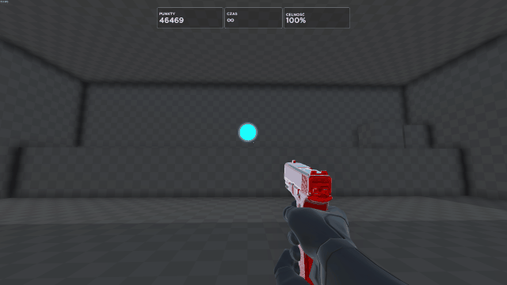
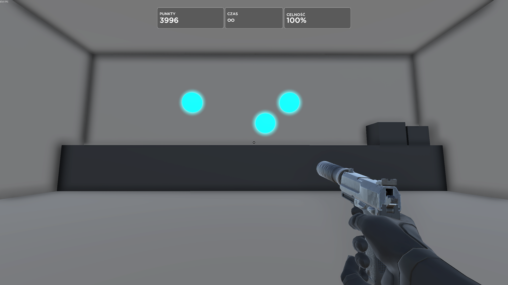
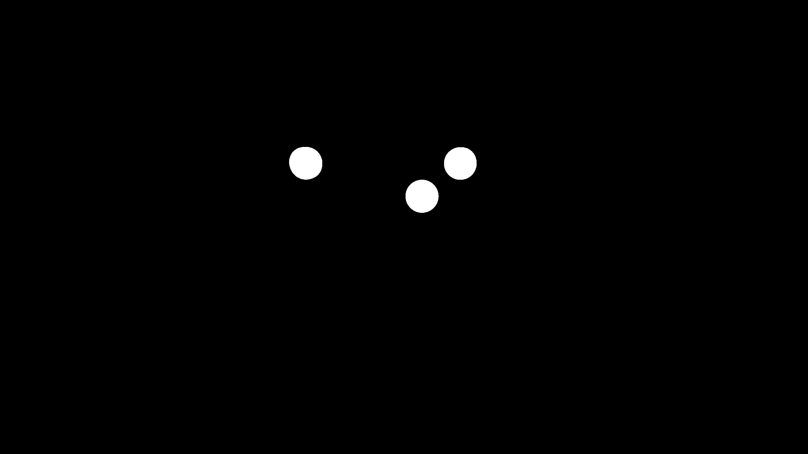

# Target tracker using computer vision

A computer vision project that detects targets and automatically moves the mouse cursor toward them. The project combines real-time screen capture, HSV colour segmentation, contour analysis, and mouse input simulation. The project was built with OpenCV and [bettercam](https://github.com/RootKit-Org/BetterCam) and tested in [Aimlabs](https://store.steampowered.com/app/714010/Aimlabs/).



> **Disclaimer:** This project was created purely for educational and proof-of-concept purposes (exploring computer vision and input automation). Do not use it in online multiplayer games. It is an independent project and is not affiliated with or endorsed by the creators of Aimlabs.

## How it works

1. **Capture** - `bettercam` grabs the configured screen region at up to 60 FPS.
2. **Mask** - The frame is converted to HSV and thresholded with the target's colour range.
3. **Filter** - Contours are kept only if their area is within limits and their shape is roughly circular.
4. **Select** - The target closest to the screen centre is chosen.
5. **Aim** - The offset from the screen centre is multiplied by `GAIN` and clamped to `MAX_STEP`, then sent as a relative mouse move. After every move the script waits a moment so the next frame already shows the result.
6. **Shoot** - When the target centre is within `CLICK_RADIUS` of the screen centre, the script clicks (with a cooldown to prevent double shots).

<table>
  <tr>
    <td align="center"><b>Game frame</b></td>
    <td align="center"><b>After applying the mask</b></td>
  </tr>
  <tr>
    <td></td>
    <td></td>
  </tr>
</table>

## Configuration

Parameters can be adjusted directly at the top of `main.py`.

| Setting | Default | Description |
|---|---|---|
| `REGION` | `(0, 0, 2560, 1440)` | Capture area: left, top, right, bottom |
| `SIZE` | `84` | Side of the downscaled grayscale observation |
| `HSV_LOW`, `HSV_HIGH` | `(80, 120, 120)`, `(100, 255, 255)` | Target colour range in HSV |
| `MIN_AREA`, `MAX_AREA` | `2`, `32000` | Allowed target area |
| `GAIN` | `0.5` | Sensitivity multiplier |
| `MAX_STEP` | `100` | Maximum mouse movement per iteration |
| `DEADZONE` | `0` | Corrections smaller than this are ignored |
| `CLICK_RADIUS` | `10` | Shoot when the target is within this many pixels of the screen centre |
| `CLICK_COOLDOWN` | `0.25` | Minimum time between two shots (s) |
| `AFTER_CLICK` | `0.15` | Wait after a shot so the hit target can disappear (s) |
| `SETTLE` | `0.03` | Wait after a mouse move so the next frame shows its effect (s) |
| `RETURN_HOME` | `False` | Move the crosshair back to its start position after each shot |
| `SHOW_DEBUG` | `False` | Show the mask window and print detection info |

## Requirements

* Windows (mouse input uses the Windows API through `ctypes`)
* Python 3.9+
* Aimlabs in windowed or borderless mode

```bash
pip install numpy opencv-python bettercam
```

## Usage

1. Turn off mouse acceleration in the game and Enhance pointer precision in Windows.
2. Set `REGION` in `main.py` to your screen resolution.
3. Run `python main.py` and switch to the game within three seconds.
4. Press **Esc** to stop.

If the game runs as administrator, start the terminal as administrator too, otherwise mouse input may be ignored.

## Technologies

* **Python** - Application logic and system interaction
* **OpenCV** - Image processing, HSV segmentation, and contour detection
* **NumPy** - Numerical operations and image array handling
* **BetterCam** - Low latency screen capture
* **ctypes** - Mouse input simulation and keyboard state detection

## Possible future improvements

* Developing a Gymnasium environment for agent interaction.
* Reinforcement learning agent using the grayscale observation instead of the hand-written aiming logic.

